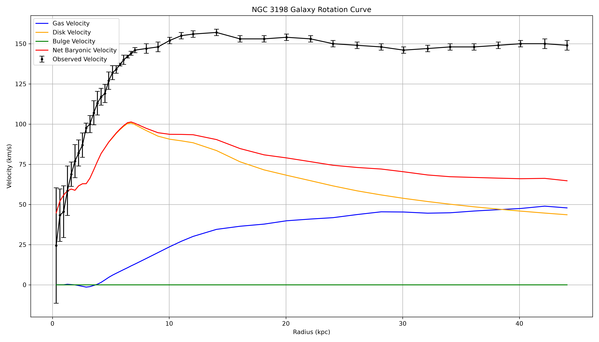
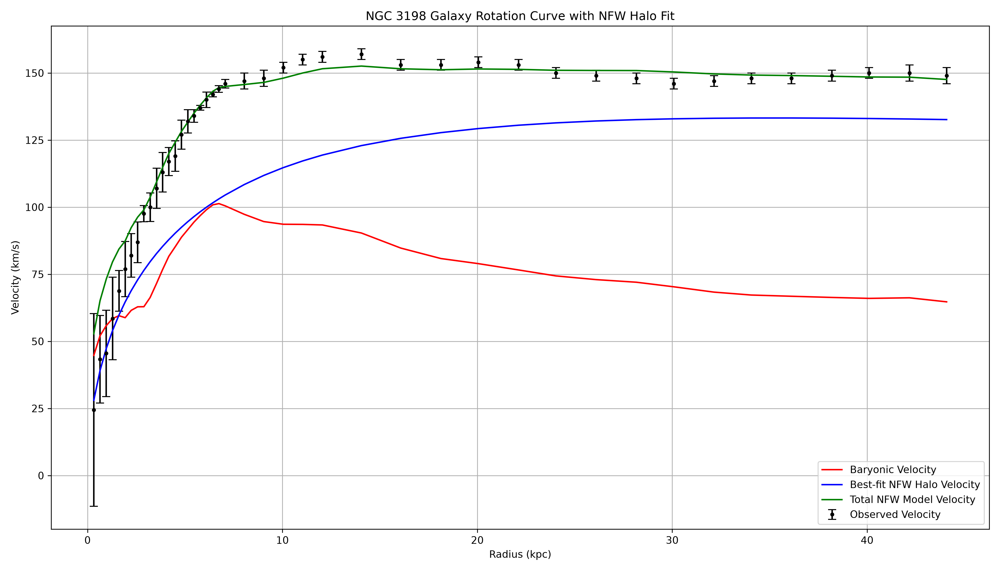
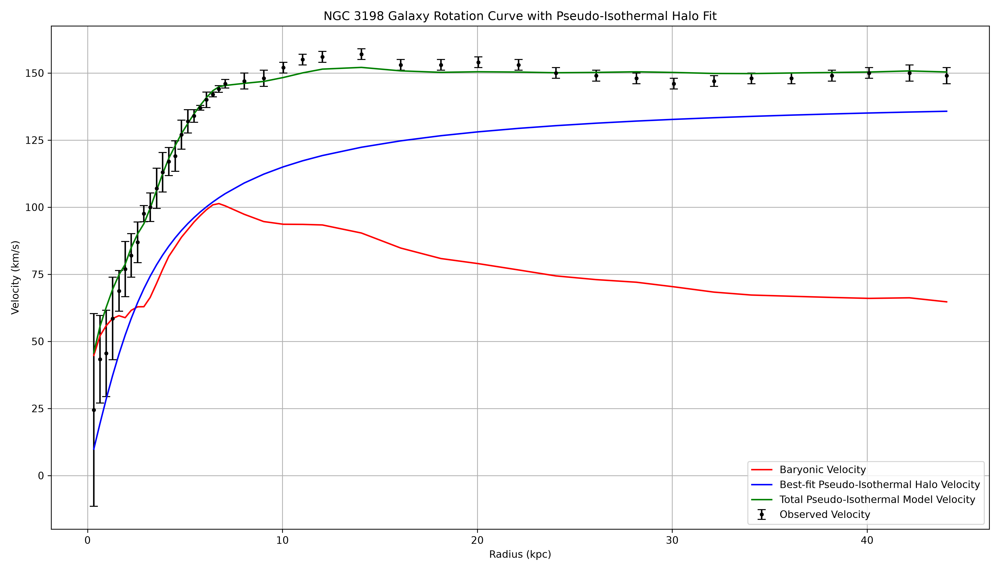
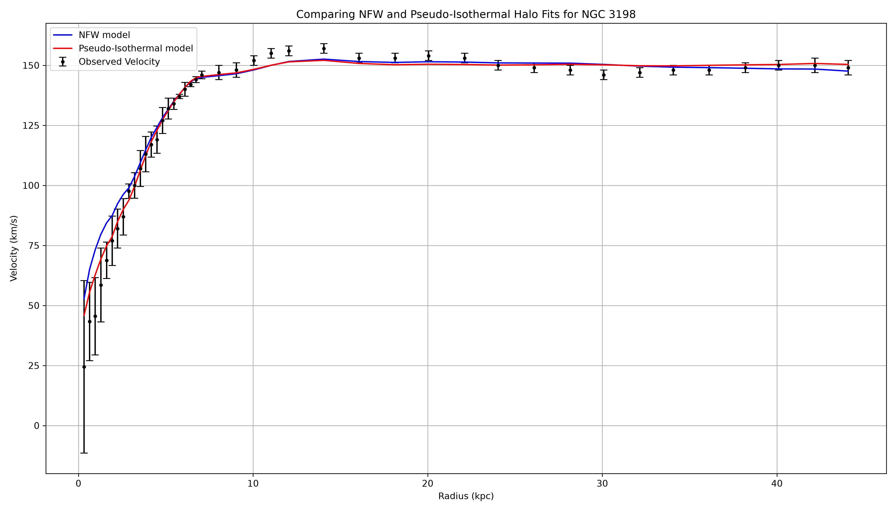
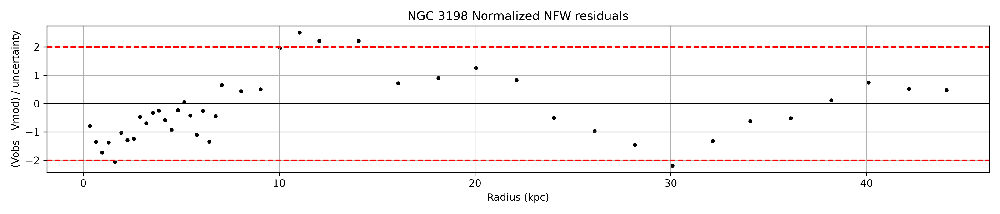
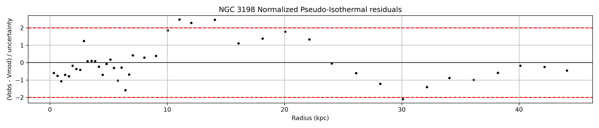
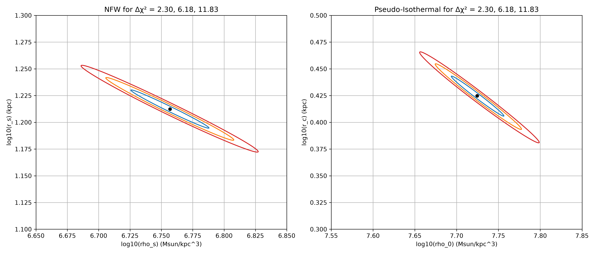
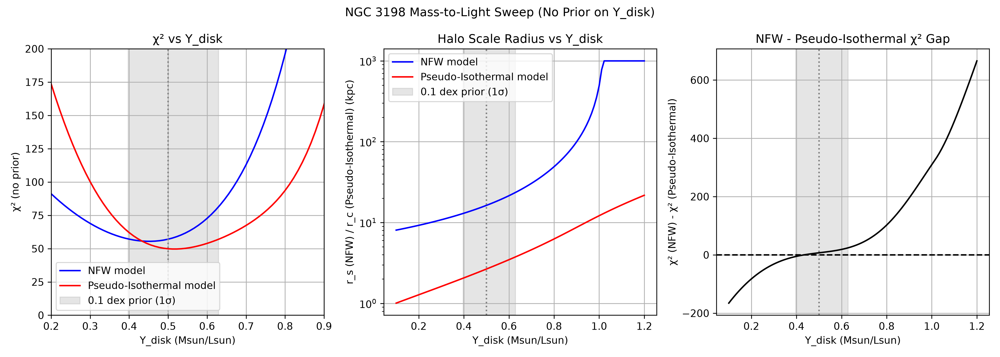
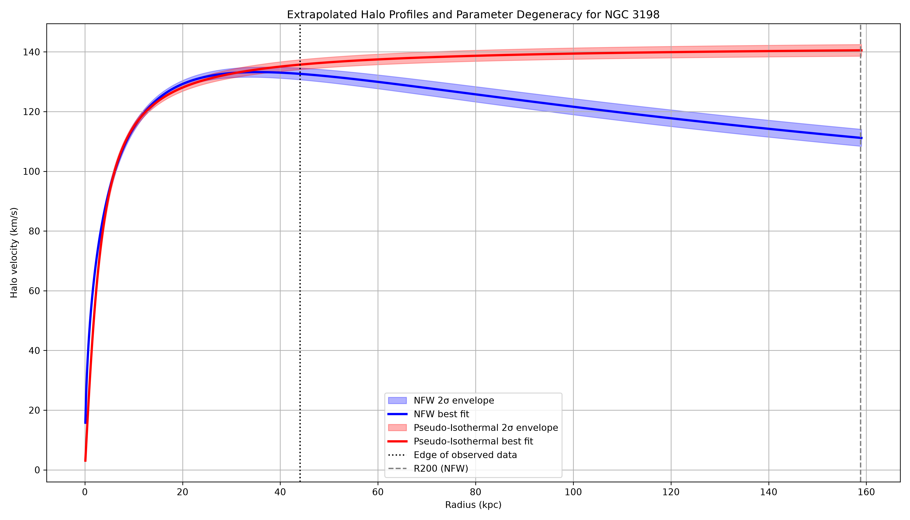

# Dark Matter Halo Profile Fitting: NGC 3198

A small rotation-curve analysis using **SciPy's `least_squares`** to fit **NFW** (cuspy) and **Pseudo-Isothermal** (cored) dark matter halo models to the SPARC rotation curve of the spiral galaxy NGC 3198, then testing how robust the result is to the assumed stellar mass-to-light ratio and to the choice of halo profile.

## Overview

The notebook decomposes the observed rotation curve of NGC 3198 into gas, stellar disk and dark matter contributions. The baryonic part is fixed from the SPARC photometry and the halo is fitted on top of it, so any velocity the baryons cannot explain is attributed to the halo.

**Analysis stages:**
1. Load the SPARC rotation-curve data (43 radial points out to ~44 kpc) and build the baryonic velocity curve
2. Fit an NFW halo (p_s, r_s) with a weighted χ² and `least_squares`
3. Fit a Pseudo-Isothermal halo (p0, r_c) the same way
4. Inspect residuals (runs test, lag-1 autocorrelation) and the parameter degeneracy (covariance from the Jacobian, Δχ² contours)
5. Estimate R200, M200 and c200 from the NFW fit
6. Sweep the stellar mass-to-light ratio Υ_disk with no prior and refit both models at each value
7. Extrapolate both halos out to R200 with a 2σ parameter envelope

## Method

Total circular velocity is the baryons and halo added in quadrature:

V_tot^2 = v_gas.|v_gas| + Y_disk.v_disk^2 + Y_bul.v_bul^2 + v_halo^2

- **Distance** is fixed at 13.8 Mpc, as quoted in the SPARC file header. The SPARC velocity decomposition and the kpc radii both depend on it.
- **v_gas** is signed-squared since it can go negative near the centre due to the geometry of the gas distribution.
- **Υ_disk = 0.5** M_sun/L_sun at 3.6 µm (standard SPARC value, Lelli, McGaugh & Schombert 2016). The bulge contribution is zero at every radius for this galaxy.
- **NFW halo:** M(r) = 4π.p_s.r_s^3.[ln(1+x) − x/(1+x)], with x = r / r_s
- **Pseudo-Isothermal halo:** M(r) = 4π.p0.r_c^3.[x − arctan(x)], with x = r / r_c
- Both models are fitted in log10 of the parameters, with residuals weighted by the quoted velocity uncertainties.
- R200 uses H0 = 70 km/s/Mpc and is defined by M(<R200) / (4/3 π R200^3) = 200 p_crit.

## Results

### Rotation curve


*Observed rotation curve (black) with the gas, disk and net baryonic contributions. The curve flattens at ~150 km/s while the baryons fall off.*

At ~44 kpc the baryons supply ~65 km/s out of ~150 km/s, which is only ~19% of the velocity squared. NGC 3198 is therefore strongly dark matter dominated at large radii.

### Halo fits (Υ_disk = 0.5)

| Parameter | NFW | Pseudo-Isothermal |
|---|---|---|
| **Central / characteristic density** | p_s = 5.71 × 10^6 M_sun/kpc^3 | p0 = 5.3 × 10^7 M_sun/kpc^3 |
| **Scale radius** | r_s = 16.3 kpc | r_c = 2.66 kpc |
| **χ²** (41 dof) | 57.09 | 49.89 |
| **Reduced χ²** | 1.39 | 1.22 |
| **p-value** | 0.049 | 0.16 |
| **Parameter correlation (log10)** | −0.989 | −0.989 |
| **Points beyond 2σ** | 5 | 4 |

Formal 1σ errors on log10 of each parameter are ~0.01-0.02 dex (a factor of ~1.03-1.05).


*NFW halo fit. The halo overtakes the baryons at ~1.6 kpc and the halo velocity has a very flat peak at ~30-35 kpc.*


*Pseudo-Isothermal halo fit. The halo overtakes the baryons at ~2.5 kpc and keeps approaching an asymptote instead of peaking.*


*Both models plotted together against the data. Inside the observed range they are almost indistinguishable by eye.*

The Pseudo-Isothermal model fits slightly better, but the difference (Δχ² = 7 for the same number of free parameters) is mild.

### NFW halo properties

| Quantity | Value |
|---|---|
| **R200** | 159 kpc |
| **M200** | 4.6 × 10^11 M_sun |
| **c200** | 9.7 |

### Residuals and degeneracy


*Normalized NFW residuals. They come in long runs of the same sign instead of scattering randomly.*


*Normalized Pseudo-Isothermal residuals show the same wave-like pattern.*

| Diagnostic | NFW | Pseudo-Isothermal |
|---|---|---|
| **Runs test** (observed / expected) | 6 / 21.1 | 7 / 21.1 |
| **Runs test z-score** | −5.0 | −4.7 |
| **Lag-1 autocorrelation** | +0.83 | +0.80 |


*Δχ² contours (1, 2, 3 σ for two free parameters) for both models. Both show a long, thin, tilted ellipse, so the data fix one combination of the two parameters much better than either one alone.*

### Mass-to-light sweep


*χ², halo scale radius and the χ² gap between the two models as a function of Υ_disk, with no prior applied. The grey band is a 0.1 dex (1σ) prior around 0.5.*

| | NFW | Pseudo-Isothermal |
|---|---|---|
| **Best-fit Υ_disk** | 0.46 | 0.51 |
| **Υ_disk range (Δχ² < 1)** | 0.42 to 0.49 | 0.49 to 0.56 |
| **Minimum χ² (no prior)** | 55.5 | 49.7 |

- The data alone is largely consistent with the standard SPARC value of 0.5 for both models.
- The halo scale radius grows with Υ_disk for both models. The NFW r_s hits its upper fit bound of 1000 kpc for Υ_disk above ~1.0, which is a fitting limit and not physical.
- Which model is preferred depends on Υ_disk. NFW is preferred below Υ_disk ≈ 0.43, while the Pseudo-Isothermal model is preferred above it (Δχ² of about +7 at 0.5 and +24 at 0.63).

### Extrapolation to R200


*Halo-only velocity for both models extrapolated to R200 (159 kpc), with 2σ parameter envelopes. The dotted line marks the edge of the data.*

| At 159 kpc | NFW | Pseudo-Isothermal |
|---|---|---|
| **Halo velocity (2σ envelope)** | 108.4 to 114.1 km/s | 138.6 to 142.5 km/s |

Within the data (below ~44 kpc) the two models are nearly identical, but they separate by ~30 km/s at R200. The parameter degeneracy barely matters for the extrapolation, so the model choice dominates the uncertainty.

> **Note on uncertainties:** The residuals of both fits are strongly correlated (see the runs test and lag-1 autocorrelation above), so the 43 points are not independent. The χ² values, p-values, parameter errors and 2σ envelopes are therefore likely too optimistic. The envelope itself is just the range of grid points with Δχ² ≤ 6.18, and not a probability band.

## Limitations

- **Correlated residuals:** Neither model captures the structure in the residuals, so the quoted fit statistics should be treated as approximate.
- **Two profiles only:** Only NFW and Pseudo-Isothermal halos were tested. A mild preference for a core does not rule out ΛCDM, since baryonic feedback can create cores.
- **Extrapolation is not a prediction:** The Pseudo-Isothermal halo has unbounded mass, so it is unphysical beyond R200. R200, M200 and c200 come only from the NFW fit, sit ~3.6 times beyond the data and have no propagated uncertainties. The extrapolated curves also show the halo only, without baryons.
- **Inner region:** Below ~3 kpc the data is noisy, have large error bars and are baryon dominated, so the cusp vs core question cannot be tested here.
- **Fixed inputs:** The main fits fix Υ_disk = 0.5. The extrapolations are conditional on this choice and Υ_disk was not marginalised over. Distance (13.8 Mpc), inclination and non-circular motions are also not varied or modelled.

Telling the two halos apart would need tracers well beyond the last data point, such as weak lensing, satellite kinematics or extended HI.

## Requirements

- Python 3.8+
- `numpy`
- `scipy`
- `matplotlib`

```bash
pip install numpy scipy matplotlib
```

## Usage

Download the SPARC rotation-curve file for NGC 3198 and place it at `sparc_data/NGC3198_rotmod.dat`, then open and run `NGC3198.ipynb` top to bottom.

To adapt for a different galaxy, change the filename in the data loading cell, and revisit the plotting limits for the del chi2 contours and the extrapolation range, since both are zoomed in on this galaxy's best-fit region.

## References

- Lelli, F., McGaugh, S. S. & Schombert, J. M. (2016): [SPARC: Mass Models for 175 Disk Galaxies with Spitzer Photometry and Accurate Rotation Curves](https://doi.org/10.3847/0004-6256/152/6/157)
- Navarro, J. F., Frenk, C. S. & White, S. D. M. (1996): [The Structure of Cold Dark Matter Halos](https://doi.org/10.1086/177173)
- [SPARC database](http://astroweb.cwru.edu/SPARC/)